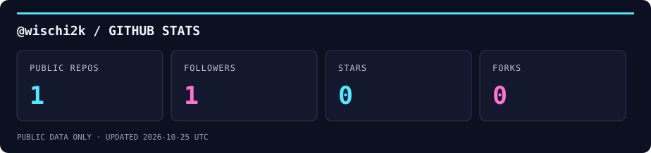

  

<strong>Gaming · AI · Home Automation · 3D Printing · Selfhosting</strong>

## Hi, ich bin @wischi2k 👋

Hier ist Platz für Freizeitprojekte, neue Ideen und Dinge, die einfach Spaß machen.

| Thema | Was mich daran reizt |
| :--- | :--- |
| 🎮 **Gaming** | Zocken, Retro-Feeling und eigene Spielideen. |
| 🤖 **AI** | Mit KI experimentieren und kreative Ideen ausprobieren. |
| 🏠 **Home Automation** | Das Zuhause mit kleinen Automationen angenehmer machen. |
| 🖨️ **3D Printing** | Ideen entwerfen, drucken und in die Hand nehmen. |
| 🖥️ **Selfhosting** | Eigene Dienste betreiben und am Homelab tüfteln. |

## GitHub in Zahlen

Öffentliche GitHub-Daten · täglich automatisch aktualisiert · Sterne und Forks der eigenen öffentlichen Repositories (ohne eigene Forks). Stand siehe Grafik.
